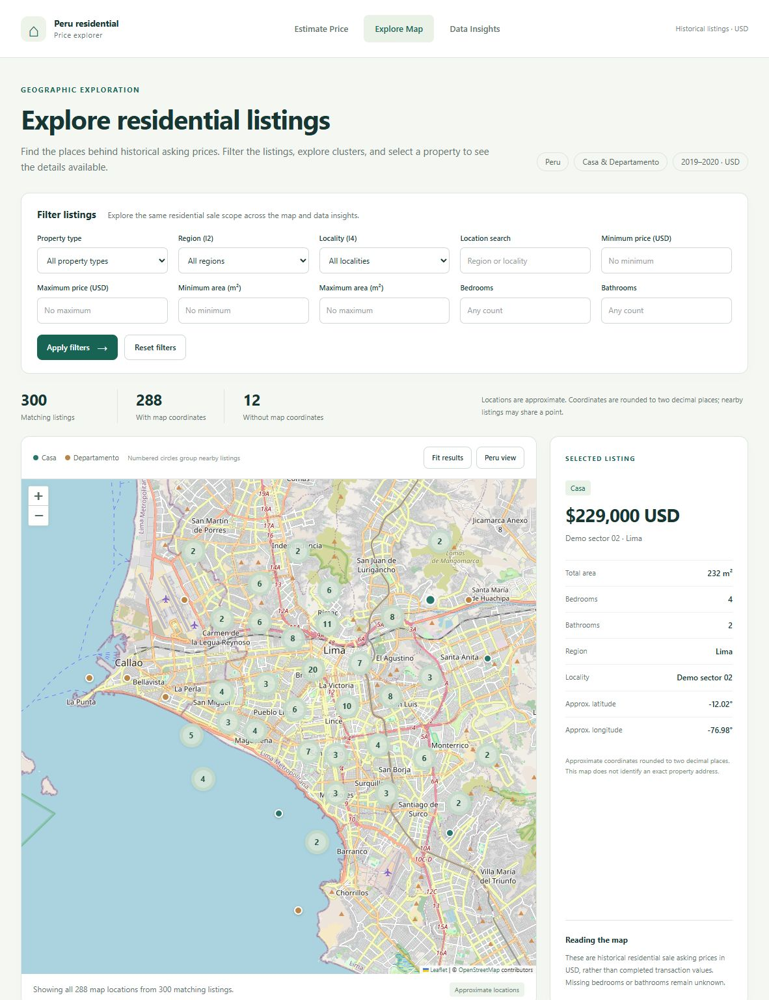
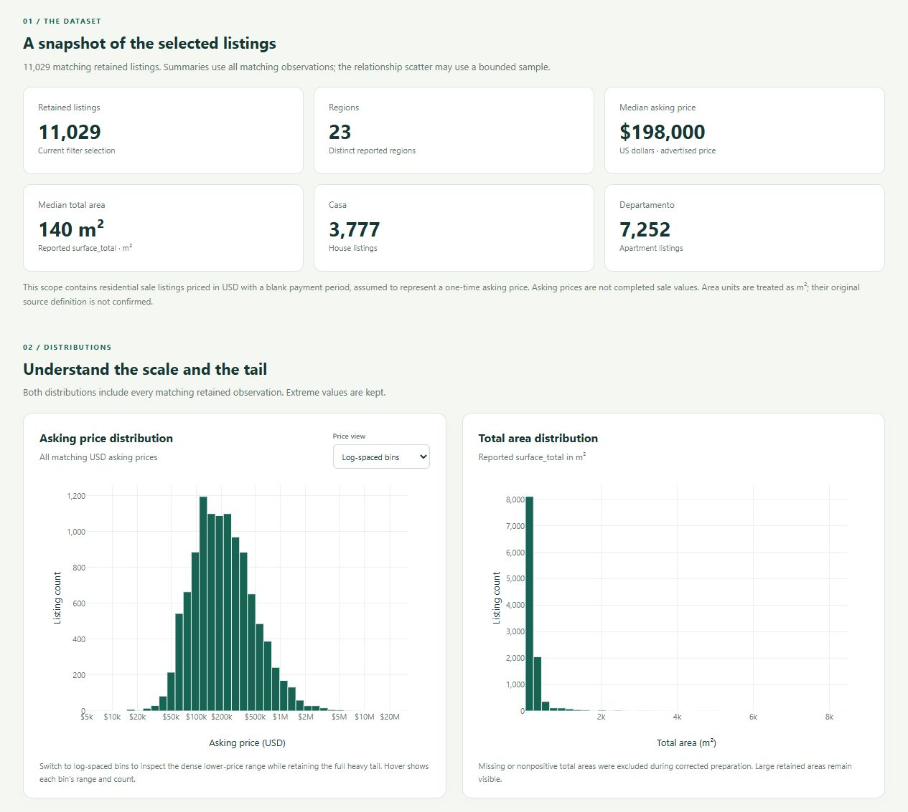
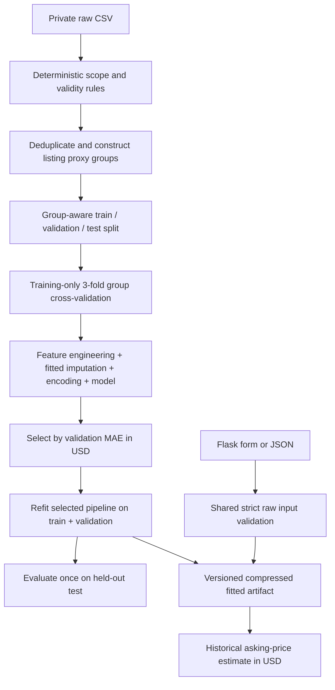

# Peru Residential Price Explorer

A reproducible data science application for historical residential sale asking prices in Peru. Estimate a price with a fitted scikit-learn pipeline, explore listings on a clustered interactive map, and examine distributions, regional comparisons, and model diagnostics in an interactive dashboard.

The project combines data validation, reusable preprocessing, group-aware evaluation, Flask backend engineering, Leaflet mapping, Plotly analytics, and automated tests. Its historical asking-price estimates are a research demonstration; held-out performance does not support reliable current-market valuation.

## Application

**Estimate Price | Explore Map | Data Insights** share navigation, typography, and a consistent residential sale scope.

- **Estimate Price** (`/`): validated property inputs, USD estimates from the exact fitted pipeline, and understandable missing-model errors.
- **Explore Map** (`/explore`): a full-size Leaflet map with clustered points, hover previews, selected-property details, pan/zoom, and shared property/location/price/area/count filters.
- **Data Insights** (`/insights`): dynamic summaries and interactive distributions, property-type counts, regional counts and medians, price–area scatter, numeric correlations, and verified model diagnostics.



The map screenshot uses generated fictional properties with explicitly named demo localities. No real listing records are published. Map points in the local application use authorized data and coordinates rounded to two decimals.



Leaflet and marker clustering handle the dense geographic distribution without a paid API key. Plotly provides responsive axes, hover, zoom, and linear/log views. JavaScript libraries are pinned and served locally with their licenses; only OpenStreetMap basemap tiles require internet access. See [exploration architecture and API](docs/exploration.md).

## Problem and scope

Estimate the advertised **asking price**, not a completed transaction price, for Peru residential listings labeled `Venta`, denominated in `USD`, with a **blank `price_period`**, and property type `Casa` (house) or `Departamento` (apartment). A blank period is interpreted as a total sale asking price because the operation is `Venta`; the source does not independently confirm that interpretation. Area values are assumed square metres based on the historical notebook labels.

Rentals, temporary rentals, all nonblank payment periods (including `Mensual` sale records), non-USD currencies, other property types, invalid targets, and missing/out-of-scope total area are excluded. There is no exchange-rate conversion, rent-to-sale multiplier, annualization, or inferred payment schedule.

The raw source contains 106,422 Peru listings created from 2019-05-30 through 2020-06-22. The final scope retains **11,029 observations in 9,930 feature-based listing groups** after removing 864 identical feature/price observations. The two original raw CSVs are byte-identical. Collection method, original platform attribution, detailed field definitions, and redistribution license: **Not confirmed from the provided source code/data.** See [data access and privacy](data/README.md) and the [baseline manifest](docs/baseline_manifest.json).

## Pipeline and engineering decisions



The eight raw predictors are `surface_total`, `lat`, `lon`, `bedrooms`, `bathrooms`, `property_type`, `l2`, and `l4`. Only total area and supported property type are required at inference. The optional locations use source administrative labels; no district mapping is recreated by the app.

- Total area must be 10–10,000 m²: a declared residential scope restriction, not a percentile learned from the data. Prices must be positive and finite; no valid price is clipped or removed as an outlier.
- Invalid optional training counts or coordinates become missing. User input rejects invalid, nonfinite, boolean, fractional count, oversized text, unsupported field, or unsupported property-type values. Coordinates must appear together and satisfy the broad configured Peru bounds (latitude −19 to 1, longitude −82 to −68); this is not a polygon boundary check.
- Coordinates are rounded to 0.01 degrees (roughly kilometre resolution) in the shared transformer. Haversine distance to the fixed Lima reference (−12.0464, −77.0428) uses the rounded coordinates; it is a geographic anchor, not a claim that every property belongs to Lima.
- **Room count and covered area are entirely absent in the retained scope.** Their ratios and UI inputs were removed. There is no fabricated covered/total ratio, room estimate, cluster zero, or learned geographic clustering.
- Numeric median imputation with missing indicators and scaling, categorical mode imputation, and one-hot encoding are fitted only inside each training fold. Unknown administrative categories are accepted and encoded with no learned category contribution.
- The three non-baseline models fit `log1p(price)` through `TransformedTargetRegressor`, which converts predictions back with `expm1`. All reported MAE/RMSE/R² use original USD prices. The dummy baseline predicts the training median directly in USD.
- No RFE, target-dependent clipping, listing duration/end-date features, or preprocessing fitted across the full dataset is retained.

Groups hash predictor values after coordinate rounding, independently of price. Equal feature proxies stay in one partition; they can represent reposts or coincidentally similar properties. Conflicting repeated listing IDs fail before training and require resolution. The provided source IDs are unique. Proxy grouping cannot establish complete property identity; see [methodology and limitations](docs/methodology.md).

## Corrected experiment

Full training ran locally on the provided real CSV with seed 42 and the pinned environment. Group splits produced **6,625 training**, **2,209 validation**, and **2,195 test** rows. Three-fold GroupKFold CV runs only on training rows. Four fixed candidates use modest configurations, without a hyperparameter search. Selection uses the lowest validation MAE; only the selected model is refitted on train + validation and evaluated on test.

| Model | CV MAE mean ± SD (USD) | CV RMSE mean (USD) | CV R² mean | Validation MAE (USD) | Validation RMSE (USD) | Validation R² |
|---|---:|---:|---:|---:|---:|---:|
| Median dummy baseline | 197,694 ± 1,301 | 422,443 | −0.0820 | 181,092.98 | 372,412.13 | −0.0686 |
| Ridge on log price | 136,228 ± 12,422 | 568,558 | −1.3546 | 114,004.51 | 349,134.99 | 0.0608 |
| Histogram Gradient Boosting on log price | 83,983 ± 3,956 | 235,711 | 0.6630 | 73,451.06 | 182,533.28 | 0.7433 |
| **Random Forest on log price** | **84,487 ± 4,811** | **234,239** | **0.6671** | **73,225.85** | **182,942.79** | **0.7421** |

Random Forest narrowly wins validation MAE ($225.22 lower than boosting, about 0.31%); this does not establish statistical superiority. It uses 100 trees, depth at most 16, minimum leaf size 4, and two workers. The compressed complete artifact is **4,887,387 bytes (4.66 MiB)** versus the original 330,836,593-byte model.

| Final held-out metric | Random Forest |
|---|---:|
| MAE (USD) | **90,684.97** |
| RMSE (USD) | **728,516.72** |
| R² | **0.1423** |

The weak held-out R² and large RMSE matter: retained asking prices span $5,000–$33,218,002, and extreme observations strongly affect squared errors. No target winsorization hides those errors. This random grouped test estimates historical in-scope generalization, not future prices, unseen-region performance, or causal effects. Legacy notebook scores and an earlier intermediate-schema run are not these final results. The exact final-run metadata and all fold scores are in [evaluation.json](docs/results/evaluation.json).


Residual analysis and validation permutation importance are interactive on the dashboard, with [aggregate figures](docs/results/) also available. Importance measures the increase in validation MAE after shuffling a raw input, with three repeats, on the selected pipeline before the development refit. It is clearly distinguished from final held-out diagnostics. Correlated inputs can redistribute importance, and the result is not causal. Listing-level predictions remain private.

## Repository

```text
real-estate-price-prediction/
├── src/real_estate/
│   ├── config.py             # paths, feature schema, bounds
│   ├── data.py               # scope filtering, cleaning, deduplication, groups
│   ├── features.py           # deterministic coarse geography
│   ├── pipeline.py           # canonical fitted preprocessing and candidates
│   ├── train.py              # split, CV, selection, final fit, artifact
│   ├── evaluate.py           # original-USD metrics and aggregate figures
│   ├── predict.py            # artifact contract and validated inference
│   ├── validation.py         # shared public input validation
│   ├── explorer.py           # allowlisted local artifact and verified evaluation
│   ├── prepare_explorer.py   # reproducible exploration export CLI
│   ├── filters.py            # authoritative shared filter validation
│   ├── analytics.py          # summaries, distributions, correlations, pagination
│   ├── web.py                # Flask pages, JSON APIs, and local entry point
│   ├── templates/            # shared shell, estimator, map, insights
│   └── static/               # styles, interaction code, pinned vendor assets
├── tests/                    # synthetic data, no source dataset dependency
├── notebooks/exploratory_analysis.ipynb
├── scripts/                 # authorized extraction and vendor verification
├── data/README.md            # ignored raw CSV lives under data/raw/
├── models/README.md          # ignored local pipeline.joblib
├── artifacts/README.md       # ignored local generated experiment output
├── docs/                    # methodology, review report, baseline, public results
├── .github/workflows/tests.yml
├── pyproject.toml
├── requirements.txt
├── constraints.txt
└── .gitignore
```

Historical notebooks, old processed CSVs, Tableau files, and the old Flask/model remain preserved in the original ZIPs outside this repository. The baseline manifest records their provenance. Their useful analytical questions informed the current dashboard, but charts are regenerated from the corrected scope. Mixed rental/sale targets, excluded property types, missing covered-area/room features, legacy category codes, geographic clusters, listing-duration features, old residuals, and obsolete model scores are excluded. The output-free exploratory notebook uses reusable modules and the training partition.

## Windows / VS Code setup

Open **this repository folder** in VS Code. Use Python **3.12–3.14**; the complete local verification used Windows with Python **3.14.7**. In a PowerShell terminal at the repository root:

```powershell
python --version
python -m venv .venv
.\.venv\Scripts\Activate.ps1
python -m pip install --upgrade pip
python -m pip install -r requirements.txt
python -m pip check
```

`requirements.txt` installs the package in editable mode and pins runtime/test dependencies with `constraints.txt`. Select `.venv\Scripts\python.exe` as the VS Code interpreter. If PowerShell blocks activation, use `.\.venv\Scripts\python.exe` instead of `python` for each command below; activation is a convenience, and no execution-policy change is required.

The verified private development environment contains the raw CSV, fitted pipeline, and generated exploration artifact. **The public repository and source export exclude all three.** A fresh clone requires authorized data access and local regeneration. Restore the known raw data from either original archive:

```powershell
python scripts/prepare_data.py --archive "C:\path\to\DS-PRO Code.zip"
```

Use your archive path in that command; source files need no path edits. The script verifies the dataset hash, extracts only the known CSV, and refuses to overwrite different data. If your dataset is another authorized file matching the schema, train with `--data "C:\path\to\your.csv"` instead; its resulting metrics may differ.

Train the complete model and local evaluation outputs, then prepare map/dashboard data:

```powershell
python -m real_estate.train
python -m real_estate.prepare_explorer
# Optional explicit paths; defaults already resolve against this repository:
# python -m real_estate.train --data "C:\path\to\your.csv" --model models/pipeline.joblib
```

Run the data-independent tests and start the app:

```powershell
python -m pytest
python -m real_estate.web
```

Open [the local application](http://127.0.0.1:5000). The server binds to localhost with debug and the reloader disabled. Stop it with Ctrl+C. If port 5000 is occupied, use `python -m flask --app real_estate.web:create_app run --host 127.0.0.1 --port 5001 --no-debugger --no-reload`.

No `.env`, paid API key, historical model, or manually rebuilt encoder is required. Module commands resolve default paths against the repository. Location filter options come only from the prepared allowlisted artifact. A missing/incompatible model produces a safe 503 and training instructions; restart after replacing a model already cached by the running app. Missing exploration data displays setup guidance on both exploration pages, with the preparation command also shown on the map. You can generate exploration data before training; unavailable model diagnostics remain clearly marked.

Example API request with invented property details:

```powershell
$property = @{surface_total=120; property_type="Departamento"; bedrooms=3; bathrooms=2; l2="Lima"; l4="Synthetic demo locality"}
Invoke-RestMethod -Uri http://127.0.0.1:5000/api/predict -Method Post -ContentType "application/json" -Body ($property | ConvertTo-Json)
```

`GET /health` returns 200 when the fitted artifact loads; missing, corrupt, unfitted, or incompatible artifacts return 503. Predictions return `prediction_usd`, `currency`, and `target`; bad input returns 400, oversized bodies 413, and unexpected application failures a safe 500.

## Verification

Tests use synthetic fixtures and run without private data or a pretrained model. They cover the preserved pipeline and estimator, shared filter validation, artifact allowlists and caching, pagination, dynamic summaries, full-tail histograms, pairwise correlations, bounded scatter sampling, evaluation provenance, and safe missing/corrupt-file behavior. Browser verification covers navigation, prediction, map tooltips/details, filtering/reset, interactive charts, and empty selections. See [verification and publication review](docs/verification.md) for final test counts and clean-install evidence.

**205 tests passed in both the working project and a clean public export**, including all 112 existing tests and 93 new regressions. The clean export installed exact dependencies into a separate empty environment, verified all bundled browser assets, and passed safe missing-data/model route checks without private files.

The CI matrix targets Windows/Linux and Python 3.12/3.14, with package consistency, compilation, offline vendor checks, and synthetic tests. Remote CI has not run because nothing has been pushed.

## Data, artifacts, and publication

Raw/processed data, real listing text, contact information, point-level exploration JSON, model binaries, per-listing outputs, ZIPs, environments, IDE caches, and notebook checkpoints are ignored. Only code, reviewed aggregate results, and safe application screenshots are committed. The map API serves only price, area, property type, optional bedroom/bathroom counts, sanitized region/locality, and rounded coordinates; it exposes no source IDs, addresses, descriptions, sellers, emails, or phones. Keep the application local: rounded coordinates do not establish permission to publish records. Joblib artifacts execute Python content; load trusted, locally generated files and retrain after dependency changes.

MOIB's original project materials are subject to the [copyright and usage terms](COPYRIGHT.md). No permissive open-source license is granted for those materials. Bundled libraries retain their own licenses; no public dataset or model redistribution permission is asserted. Git records actual changes without rewriting earlier history. No remote, push, public repository, or merge was created.

## Limitations and future work

The source target/period and area-unit assumptions still need authoritative confirmation. Data is old, asking prices can be incorrect, features are sparse, and complete listing identity is unknown. Broad coordinate bounds cannot establish a location inside Peru. Missing inputs or unseen administrative categories can make estimates less reliable. There are no calibrated intervals, drift monitoring, time-based backtest, or geographic holdout, and held-out performance is insufficient for reliable current valuation. The final model is chosen by validation MAE, so a slight win over boosting is not conclusive.

Useful next steps are confirming provenance/schema/rights, acquiring recent licensed data and real transaction targets, improving entity resolution, evaluating chronological and spatial splits, validating extreme records without silently clipping labels, testing uncertainty calibration, and comparing constrained boosting under a documented tuning budget.

Stack: Python, pandas, NumPy, scikit-learn, Flask/Jinja, Leaflet, MarkerCluster, Plotly.js, joblib, Matplotlib, pytest, PowerShell, and GitHub Actions. The pipeline follows scikit-learn's [guidance on consistent preprocessing and leakage prevention](https://scikit-learn.org/stable/common_pitfalls.html).

## Author

**MOIB**

© 2026 MOIB. All rights reserved unless otherwise stated.

See [COPYRIGHT.md](COPYRIGHT.md) for ownership and usage terms.
