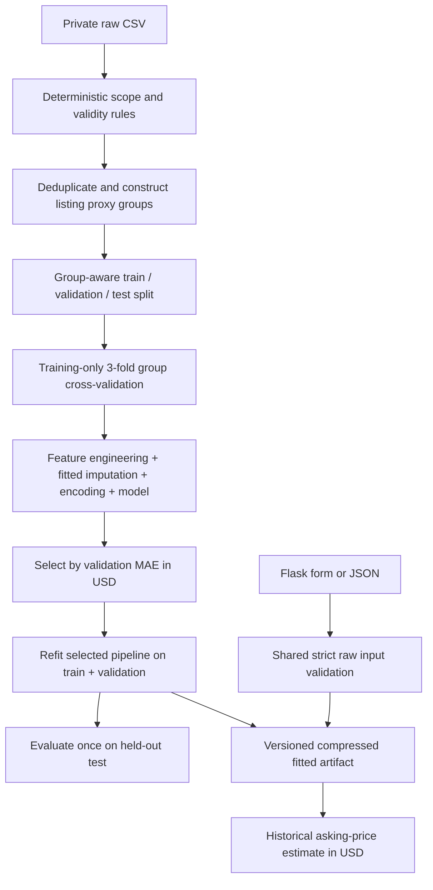
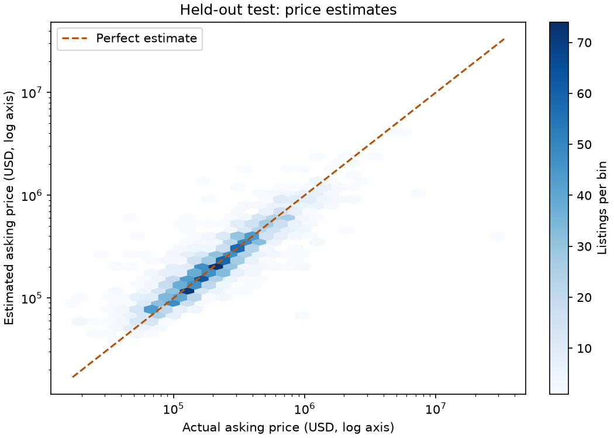
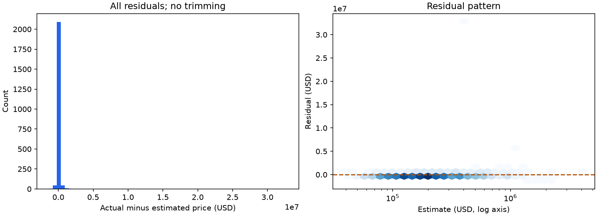
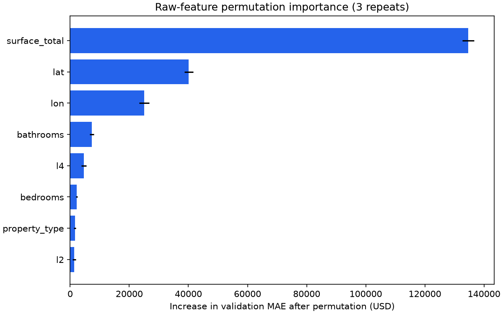
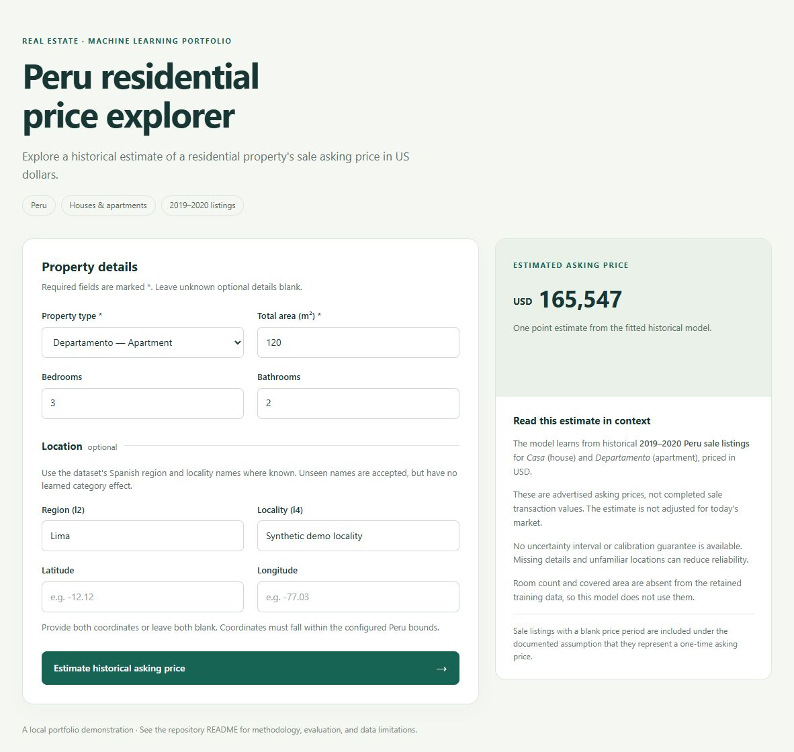

# Peru Residential Asking Price Estimation

A reproducible Python ML portfolio project that estimates historical residential sale asking prices in USD. One fitted scikit-learn estimator serves both evaluation and a small Flask application, with explicit target semantics, group-aware evaluation, and synthetic tests that run without private data.

This Phase 2 repository consolidates two historical versions of the same project. It demonstrates data validation, reusable feature engineering, leakage prevention, model comparison, artifact management, testing, and application integration. It is a local research demonstration, not a production valuation service.

## Problem and scope

Estimate the advertised **asking price**, not a completed transaction price, for Peru residential listings labeled `Venta`, denominated in `USD`, with a **blank `price_period`**, and property type `Casa` (house) or `Departamento` (apartment). A blank period is interpreted as a total sale asking price because the operation is `Venta`; the source does not independently confirm that interpretation. Area values are assumed square metres based on the historical notebook labels.

Rentals, temporary rentals, all nonblank payment periods (including `Mensual` sale records), non-USD currencies, other property types, invalid targets, and missing/out-of-scope total area are excluded. There is no exchange-rate conversion, rent-to-sale multiplier, annualization, or inferred payment schedule.

The raw source contains 106,422 Peru listings created from 2019-05-30 through 2020-06-22. The final scope retains **11,029 observations in 9,930 feature-based listing groups** after removing 864 identical feature/price observations. The two original raw CSVs are byte-identical. Collection method, original platform attribution, detailed field definitions, and redistribution license: **Not confirmed from the provided source code/data.** See [data access and privacy](data/README.md) and the [baseline manifest](docs/baseline_manifest.json).

## Pipeline and engineering decisions



The eight raw predictors are `surface_total`, `lat`, `lon`, `bedrooms`, `bathrooms`, `property_type`, `l2`, and `l4`. Only total area and supported property type are required at inference. The optional locations use source administrative labels; no district mapping is recreated by the app.

- Total area must be 10–10,000 m²: a declared residential scope restriction, not a percentile learned from the data. Prices must be positive and finite; no valid price is clipped or removed as an outlier.
- Invalid optional training counts or coordinates become missing. User input rejects invalid, nonfinite, boolean, fractional count, oversized text, unsupported field, or unsupported property-type values. Coordinates must appear together and satisfy the broad configured Peru bounds (latitude −19 to 1, longitude −82 to −68); this is not a polygon boundary check.
- Coordinates are rounded to 0.01 degrees (roughly kilometre resolution) in the shared transformer. Haversine distance to the fixed Lima reference (−12.0464, −77.0428) uses the rounded coordinates; it is a geographic anchor, not a claim that every property belongs to Lima.
- **Room count and covered area are entirely absent in the retained scope.** Their ratios and UI inputs were removed. There is no fabricated covered/total ratio, room estimate, cluster zero, or learned geographic clustering.
- Numeric median imputation with missing indicators and scaling, categorical mode imputation, and one-hot encoding are fitted only inside each training fold. Unknown administrative categories are accepted and encoded with no learned category contribution.
- The three non-baseline models fit `log1p(price)` through `TransformedTargetRegressor`, which converts predictions back with `expm1`. All reported MAE/RMSE/R² use original USD prices. The dummy baseline predicts the training median directly in USD.
- No RFE, target-dependent clipping, listing duration/end-date features, or preprocessing fitted across the full dataset is retained.

Groups hash predictor values after coordinate rounding, independently of price. Equal feature proxies stay in one partition; they can represent reposts or coincidentally similar properties. Conflicting repeated listing IDs fail before training and require resolution. The provided source IDs are unique. Proxy grouping cannot establish complete property identity; see [methodology and limitations](docs/methodology.md).

## Corrected experiment

Full training ran locally on the provided real CSV with seed 42 and the pinned environment. Group splits produced **6,625 training**, **2,209 validation**, and **2,195 test** rows. Three-fold GroupKFold CV runs only on training rows. Four fixed candidates use modest configurations, without a hyperparameter search. Selection uses the lowest validation MAE; only the selected model is refitted on train + validation and evaluated on test.

| Model | CV MAE mean ± SD (USD) | CV RMSE mean (USD) | CV R² mean | Validation MAE (USD) | Validation RMSE (USD) | Validation R² |
|---|---:|---:|---:|---:|---:|---:|
| Median dummy baseline | 197,694 ± 1,301 | 422,443 | −0.0820 | 181,092.98 | 372,412.13 | −0.0686 |
| Ridge on log price | 136,228 ± 12,422 | 568,558 | −1.3546 | 114,004.51 | 349,134.99 | 0.0608 |
| Histogram Gradient Boosting on log price | 83,983 ± 3,956 | 235,711 | 0.6630 | 73,451.06 | 182,533.28 | 0.7433 |
| **Random Forest on log price** | **84,487 ± 4,811** | **234,239** | **0.6671** | **73,225.85** | **182,942.79** | **0.7421** |

Random Forest narrowly wins validation MAE ($225.22 lower than boosting, about 0.31%); this does not establish statistical superiority. It uses 100 trees, depth at most 16, minimum leaf size 4, and two workers. The compressed complete artifact is **4,887,387 bytes (4.66 MiB)** versus the original 330,836,593-byte model.

| Final held-out metric | Random Forest |
|---|---:|
| MAE (USD) | **90,684.97** |
| RMSE (USD) | **728,516.72** |
| R² | **0.1423** |

The weak held-out R² and large RMSE matter: retained asking prices span $5,000–$33,218,002, and extreme observations strongly affect squared errors. No target winsorization hides those errors. This random grouped test estimates historical in-scope generalization, not future prices, unseen-region performance, or causal effects. Legacy notebook scores and an earlier intermediate-schema run are not these final results. The exact final-run metadata and all fold scores are in [evaluation.json](docs/results/evaluation.json).







Permutation importance measures the increase in validation MAE after shuffling a raw input, with three repeats. Correlated geographic inputs can redistribute importance, and the result is not causal. The published plots are aggregate views; listing-level predictions stay private.

## Repository

```text
real-estate-price-prediction/
├── src/real_estate/
│   ├── config.py             # paths, feature schema, bounds
│   ├── data.py               # scope filtering, cleaning, deduplication, groups
│   ├── features.py           # deterministic coarse geography
│   ├── pipeline.py           # canonical fitted preprocessing and candidates
│   ├── train.py              # split, CV, selection, final fit, artifact
│   ├── evaluate.py           # original-USD metrics and aggregate figures
│   ├── predict.py            # artifact contract and validated inference
│   ├── validation.py         # shared public input validation
│   ├── web.py                # Flask factory and local entry point
│   ├── templates/index.html
│   └── static/style.css
├── tests/                    # synthetic data, no source dataset dependency
├── notebooks/exploratory_analysis.ipynb
├── scripts/prepare_data.py
├── data/README.md            # ignored raw CSV lives under data/raw/
├── models/README.md          # ignored local pipeline.joblib
├── artifacts/README.md       # ignored local generated experiment output
├── docs/                    # methodology, review report, baseline, public results
├── .github/workflows/tests.yml
├── pyproject.toml
├── requirements.txt
├── constraints.txt
└── .gitignore
```

Historical notebooks, old processed CSVs, Tableau files, and the old Flask/model remain preserved in the original ZIPs outside this repository. The manifest distinguishes that history from this newly implemented Phase 2 code. No legacy file controls training or inference. The output-free exploratory notebook uses the reusable modules and training partition; it is optional and not a second training implementation.

## Windows / VS Code setup

Open **this repository folder** in VS Code. Use Python **3.12–3.14**; the complete local verification used Windows with Python **3.14.7**. In a PowerShell terminal at the repository root:

```powershell
python --version
python -m venv .venv
.\.venv\Scripts\Activate.ps1
python -m pip install --upgrade pip
python -m pip install -r requirements.txt
python -m pip check
```

`requirements.txt` installs the package in editable mode and pins runtime/test dependencies with `constraints.txt`. Select `.venv\Scripts\python.exe` as the VS Code interpreter. If PowerShell blocks activation, use `.\.venv\Scripts\python.exe` instead of `python` for each command below; activation is a convenience, and no execution-policy change is required.

The local deliverable already includes the ignored raw CSV and final model. For a fresh Git clone, restore authorized raw data from either original archive:

```powershell
python scripts/prepare_data.py --archive "C:\path\to\DS-PRO Code.zip"
```

Use your archive path in that command; source files need no path edits. The script verifies the dataset hash, extracts only the known CSV, and refuses to overwrite different data. If your dataset is another authorized file matching the schema, train with `--data "C:\path\to\your.csv"` instead; its resulting metrics may differ.

Train or rebuild the complete model and local evaluation outputs:

```powershell
python -m real_estate.train
# Optional explicit paths; defaults already resolve against this repository:
# python -m real_estate.train --data "C:\path\to\your.csv" --model models/pipeline.joblib
```

Run the data-independent tests and start the app:

```powershell
python -m pytest
python -m real_estate.web
```

Open [the local application](http://127.0.0.1:5000). The server binds to localhost with debug and the reloader disabled. Stop it with Ctrl+C. If port 5000 is occupied, use `python -m flask --app real_estate.web:create_app run --host 127.0.0.1 --port 5001 --no-debugger --no-reload`.

No `.env`, secret, external API, historical model, dataset-driven dropdown, or manually rebuilt encoder is required. Once installed in editable mode, the module commands work from another working directory too. A missing/incompatible model produces a safe 503 and training instructions; restart after replacing a model already cached by the running app.

Example API request with invented property details:

```powershell
$property = @{surface_total=120; property_type="Departamento"; bedrooms=3; bathrooms=2; l2="Lima"; l4="Synthetic demo locality"}
Invoke-RestMethod -Uri http://127.0.0.1:5000/api/predict -Method Post -ContentType "application/json" -Body ($property | ConvertTo-Json)
```

`GET /health` returns 200 when the fitted artifact loads; missing, corrupt, unfitted, or incompatible artifacts return 503. Predictions return `prediction_usd`, `currency`, and `target`; bad input returns 400, oversized bodies 413, and unexpected application failures a safe 500.

## Demo and verification



The screenshot is from the actual local application and an invented property, not a real listing. A live HTTP smoke test made three valid prediction requests and five invalid requests; HTML, CSS, and health endpoints returned 200. Synthetic tests additionally verify missing/corrupt/unfitted models, serialization, unseen categories, nullable inputs, geographic math, train/fold isolation, target filtering, group separation, input escaping, malformed JSON, body limits, and safe errors.

**112 automated tests passed in both the working project and a clean public export.** The export installed the final exact dependencies in a separate empty environment without the private data/model, imported its own source, and passed all tests plus the missing-model health check. Full real-data training and model loading ran successfully in the working project. Compilation and `pip check` passed. See [verification and publication review](docs/verification.md). The CI matrix is configured for Windows/Linux and Python 3.12/3.14, using synthetic fixtures; remote CI has not been run because nothing was pushed.

## Data, artifacts, and publication

Raw/processed data, real listing text, contact information, precise locations, model binaries, per-listing outputs, ZIPs, environments, IDE caches, and notebook checkpoints are ignored. Only aggregate reviewed results and a synthetic demo screenshot are committed. Joblib artifacts execute Python content: load only trusted, locally generated files and retrain after dependency changes. No public dataset license or model redistribution permission is asserted.

No license is assigned automatically: choose a code license only after confirming ownership/attribution of the original project. A code license would not license the private dataset. Git contains real commits for this Phase 2 work; no historical development is fabricated. No remote, push, public repository, or merge was created.

## Limitations and future work

The source target/period and area-unit assumptions still need authoritative confirmation. Data is old, asking prices can be incorrect, features are sparse, and complete listing identity is unknown. Broad coordinate bounds cannot establish a location inside Peru. Missing inputs or unseen administrative categories can make estimates less reliable. There are no calibrated intervals, drift monitoring, time-based backtest, or geographic holdout, and held-out performance is insufficient for reliable current valuation. The final model is chosen by validation MAE, so a slight win over boosting is not conclusive.

Useful next steps are confirming provenance/schema/rights, acquiring recent licensed data and real transaction targets, improving entity resolution, evaluating chronological and spatial splits, validating extreme records without silently clipping labels, testing uncertainty calibration, and comparing constrained boosting under a documented tuning budget.

Stack: Python, pandas, NumPy, scikit-learn, Flask/Jinja, joblib, Matplotlib, pytest, PowerShell, and GitHub Actions. The pipeline follows scikit-learn's [guidance on consistent preprocessing and leakage prevention](https://scikit-learn.org/stable/common_pitfalls.html).
